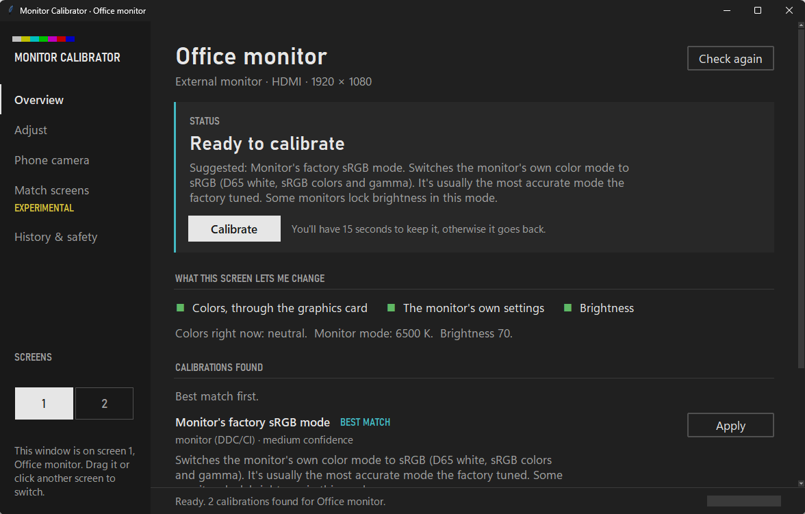
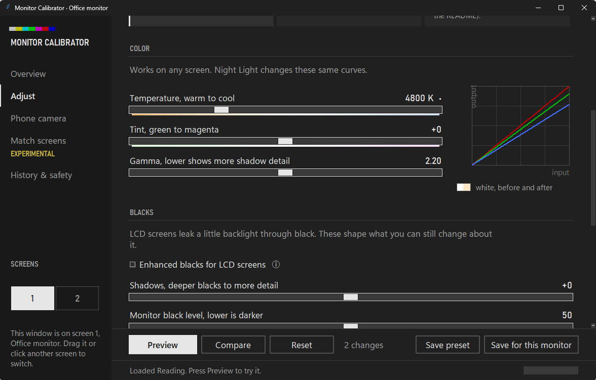
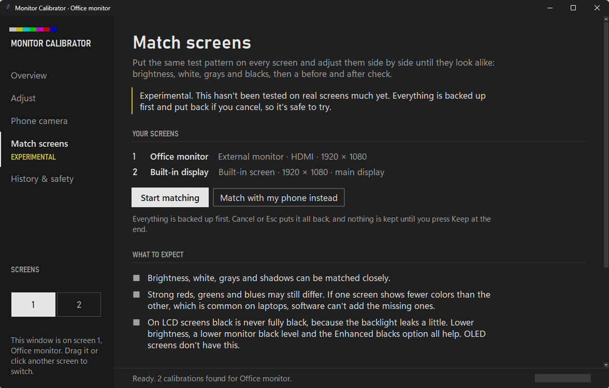

# Monitor Calibrator

A Windows app for adjusting display colors and trying to match two screens. I built it because the laptop screen and external monitor on my desk had noticeably different whites and blacks.

The app detects the monitor its window is on, suggests settings, and lets you preview them. **If you don't confirm within 15 seconds, it restores the previous settings.** A colorimeter isn't required, although this isn't a substitute for proper hardware calibration.



## What it can adjust

- **Graphics-card gamma ramps**, which affect colors on both built-in and external displays.
- **Monitor controls** through DDC/CI, when available: brightness, contrast, color mode, RGB gains, and black level.
- **Laptop brightness**, through the supported Windows display interfaces.

DDC/CI must be enabled in the monitor's own menu. Not every screen exposes every control.

## Install and run

Windows 10 or 11 is required. Double-click `Calibrate.bat`. On first launch, the installer checks whether Python is available, offers to install it if necessary, and checks optional dependencies for the phone feature. It can also add a Start menu shortcut.

```sh
python install.py             # run setup again
python install.py --check     # report dependencies, don't install
python install.py --uninstall # remove installed shortcuts
```

Move the window onto the display you want to change or select it in the screen map. **Calibrate** previews a suggestion; **Keep** accepts it and **Go back** restores the previous setting. **Adjust** has presets and individual sliders; changes are applied only when you press Preview. **Compare** switches between before/after views using sample pictures or charts.



## Matching two screens (experimental)

**Match screens** shows the same test pattern on each display and walks through brightness, whites, grays, blacks, and picture comparison. Cancel or Esc returns everything to its saved state.



**Match with my phone** takes one photo containing multiple screens, so the camera processes their whites and brightness under the same conditions. The brighter screen can then be reduced to match the dimmer one. A camera cannot create colors that a panel cannot display, so gamut differences will remain, particularly with saturated reds, greens, and blues.

## Blacks on LCD panels

LCDs still have backlight glow when displaying black, unlike OLEDs. **Enhanced blacks** changes the bottom of the gamma curve to darken near-black tones, and can adjust the monitor's black-level control when supported. It can't make an LCD backlight turn off per pixel.

If blacks are consistently gray, check whether the graphics driver is outputting **Limited** rather than **Full** RGB range. Intel, NVIDIA, and AMD provide this setting in their display-control utilities.

## Measuring gamma with a phone

Open **Phone camera**, start the local connection, and scan the QR code. Your phone and PC must be on the same Wi-Fi network. Display the chart, step back roughly two meters, and take the picture.

The chart compares solid grayscale patches with checkerboard patterns that have a known average luminance. Matching them in a photo gives an estimate of the display's gamma curve. Because the references and test patches go through the same camera processing, much of that processing cancels out. The app measures the red, green, and blue channels separately.

White-point measurement is different: the camera's automatic white balance can change the result. For that, lock white balance at 6500 K or include a trusted reference display in the shot.

Each chart also contains a fresh code (20 bits plus a checksum) so unrelated photos and stale charts are rejected. The app checks for likely screenshots and moiré problems as well; step farther away if the image shows interference patterns.

## Recovery and safety

- Every preview begins by saving the current settings.
- **History & safety** provides Undo and Restore original.
- If the app or computer closes mid-change, the next launch restores the pending state.
- `restore.bat` can restore settings without opening the main app.
- Windows may reset gamma after sleep or restart. The app can reapply kept settings on sign-in, while avoiding changes deliberately made by another color tool.

HDR and Windows Auto Color Management may override gamma-ramp settings. Some Windows configurations also limit very warm color adjustments. The optional command below removes that limit, but requires administrator permissions and a restart:

```sh
python calibrate.py --unlock-gamma-range
```

## Under the hood

The application is Python with a Tkinter interface and Windows APIs called through `ctypes`. Pillow and `qrcode` are optional dependencies used for the phone camera.

- **Display identification:** Windows display APIs find the current monitor, while EDID information from the registry helps tie saved settings to a physical screen.
- **DDC/CI:** the app talks to supported external monitors through `dxva2.dll`.
- **Gamma adjustments:** 256-entry graphics-card gamma curves alter the displayed output without changing image files.
- **Phone connection:** a small local server from Python's standard library uses a random QR token and locks the session to the first phone that connects.
- **Rollback:** the previous state is saved before a change and marked as pending until the user keeps it.

There are unit tests, including simulated photos generated from displays with known gamma values:

```sh
python -m unittest discover -s tests
```

## Command line

```sh
python calibrate.py --list
python calibrate.py --auto
python calibrate.py --restore all
python calibrate.py --restore all --original
```

`--list` reports connected displays and supported controls without changing anything. `--auto` calibrates the display associated with the console. The restore commands undo recent changes or return to the pre-app original settings.

## Privacy and limitations

The app does not require an account, send telemetry, or check for updates. The phone page runs only on the local network while it is open, with a token from the QR code and one active phone. Photos stay in memory unless you enable the option to retain the last five; retained photos are saved without location metadata. **Search online** is the exception: it opens a browser search for the monitor model when clicked.

This is mainly tested on my own laptop and external monitor. DDC/CI support varies, phone measurements are estimates, and software can't compensate for every physical difference between panels.

MIT License.
