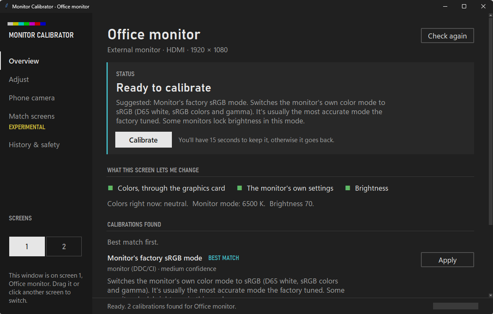
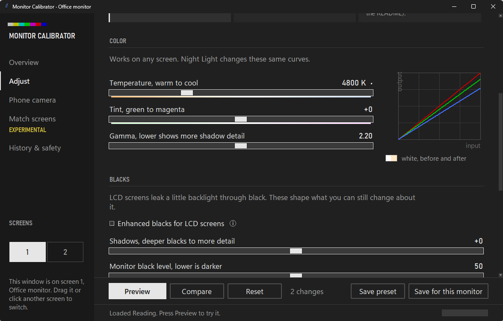
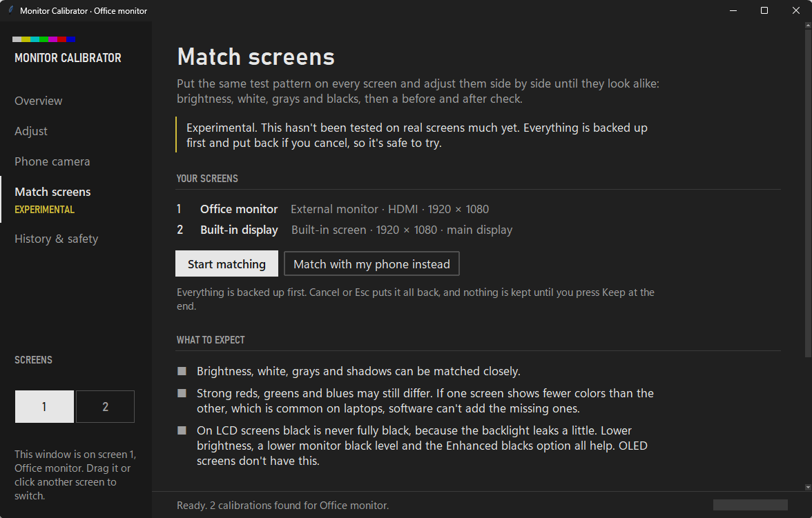

# Monitor Calibrator

A small Windows app that tunes your screens. It works out which monitor its window is on, finds the best
settings it can for it, and asks if you want to keep them. If you don't answer within 15 seconds, everything
goes back the way it was.

You don't need a colorimeter. If you have a phone, you can use it to measure the screen.



I built this for my own setup, a laptop plus one external monitor whose colors and blacks didn't match. It
should work with other screens too, but it's only been tested on that one setup, so expect some rough edges.
Every change can be undone, so trying it is safe.

## What it can change

- **Colors on any screen**, through the graphics card. It's the same thing Night Light uses.
- **The monitor's own settings**: brightness, contrast, color mode and RGB. This needs DDC/CI, which most
  external monitors have. If it's off, turn it on in the monitor's menu.
- **Laptop screen brightness.**

## Getting started

You need Windows 10 or 11. Double-click **`Calibrate.bat`**. The first time, it sets things up before opening:

- No Python yet? It offers to install it with winget, or opens the download page.
- It checks the pieces the app uses and installs the missing extras (only the phone camera needs them).
- It can add a Start menu shortcut too.

Once that's done it remembers, and from then on `Calibrate.bat` just opens the app. If you skip the extras,
the app offers them later, the first time you use the phone camera.

To run the setup again: `python install.py`. Also there: `--check` only reports, and `--uninstall` removes the
shortcuts.

The window shows what it found for the screen it's on. Press **Calibrate** to try the suggestion, then **Keep**
or **Go back**. Drag the window to another screen, or click it in the little map, and it switches to that one.

Prefer doing it by eye? The **Adjust** page has presets (Standard, Movies, Reading, Night and a few more) and
sliders for everything your screen allows. Nothing changes until you press Preview. **Compare** shows a sample
picture, a night scene or a color chart, and lets you flip between before and after.



Everything below is optional. Out of the box the app behaves the same with or without it.

## Matching two screens (experimental)

This part is new and hasn't been tested on real screens much yet. It's safe to try, since everything is backed
up and put back if you cancel, but expect rough edges.

Open **Match screens**. Every screen shows the same test pattern and you adjust them side by side: brightness,
white, grays, blacks, then a before and after check with sample pictures. Cancel or Esc puts it all back.



With a phone it gets more precise: **Match with my phone** puts a chart on every screen and you take one photo
of all of them. The camera handles every screen the same way, so the whites and brightness can be compared
directly. The brighter screen gets turned down to match, which also darkens its blacks.

What it can't do: if one screen shows fewer colors than the other (common on laptops), strong reds, greens and
blues will still look different. No software can add colors a panel doesn't have.

## Blacks on LCD screens

An LCD can't switch its backlight off for a black pixel, so black always glows a bit. OLED doesn't have this.
**Enhanced blacks** (on the Adjust page, with an ⓘ explaining it) gets as close as it can: it darkens the tones
just above black and, if the monitor allows it, lowers a raised black level. Lower brightness helps too.

If black still looks dark gray, your PC may be sending limited-range video. Set it to Full in Intel Graphics
Command Center, NVIDIA Control Panel or AMD Software. The Match screens page explains where.

## Using your phone

Open **Phone camera**, press Start and scan the QR code. Your phone and PC need to be on the same Wi-Fi. Show
the chart, step back about 2 meters, take the photo, and the PC measures the gamma of each color channel.
Your phone's own processing doesn't skew this, because the chart carries its own references.

The white point is the one thing a photo can't judge on its own. It's the same reason film crews shoot a gray
card. If you want that measured too, lock your camera's white balance at 6500 K or keep a screen you trust in
the shot.

## If something goes wrong

- Every change is backed up first. **History & safety** has Undo and Restore original.
- If the app closes mid-change, that change is undone the next time it starts.
- `restore.bat` puts every screen back without opening the app.

## Privacy

Nothing leaves your computer. No account, no tracking, no update checks.

The phone page only runs while you have it open, only on your local network, only with the code from the QR,
and only for one phone at a time. Photos stay in memory unless you turn on "keep my last 5 phone photos", and
even then they're saved without location data.

The app only touches the internet when you click **Search online**, which opens a search for your monitor's
model in your browser.

## Good to know

- It doesn't replace a hardware colorimeter. It gets you close, safely.
- Windows forgets graphics-card colors when it restarts. Turn on "put my calibration back when I sign in"
  under History & safety.
- HDR and Auto Color Management can override graphics-card color changes.
- Windows may refuse very warm tints (below about 3400 K). `python calibrate.py --unlock-gamma-range` lifts
  that limit. It needs admin rights and a restart.

## Under the hood

Plain Python talking to Windows through `ctypes`, with a Tkinter window. No compiled parts, and the only
packages it installs are Pillow and qrcode, both just for the phone camera.

- **Which screen is which.** Windows' display APIs map the window to a monitor, and the monitor's EDID (read
  from the registry) gives its model and serial number, so saved settings stay with the right screen.
- **Monitor settings** go over DDC/CI through `dxva2.dll`. These are the same commands the monitor's own
  buttons send: brightness, contrast, color mode, RGB gains and black levels.
- **Colors on any screen** are the graphics card's gamma ramps, the 256-step curves Night Light also uses.
  Enhanced blacks bends the bottom of that curve so the tones just above black get darker.
- **Gamma from a phone photo.** The chart puts checkerboard patches (half black, half white pixels, so a known
  amount of light) next to a ladder of solid grays. Whichever solid gray looks the same as a checkerboard
  in the photo tells you the screen's gamma. The camera's own tone curve applies to both, so it cancels out.
- **Is that really the chart?** Every chart shows a fresh code (20 bits plus a checksum) that the photo has
  to contain, so old photos and random pictures are refused. Screenshots are too, since they never went
  through the screen. Moiré stripes get flagged so you know to step back.
- **The phone link** is a small server from Python's standard library. It only listens on your local
  network, needs the random token from the QR code, and locks to the first phone with a private cookie.
- **Undo.** Before any change the current state is saved to disk, and the change is marked as pending until
  you keep it. If the app or PC dies in between, the next start puts things back. And while the app is open,
  if Windows resets the colors (it does after sleep, for example), the kept ones go back on. A curve set by
  Night Light or another app is left alone.

There are unit tests, including synthetic photos of screens with a known gamma, to check the phone
measurement gets it right:

```
python -m unittest discover -s tests
```

## Command line

```
python calibrate.py --list           what each screen supports (changes nothing)
python calibrate.py --auto           calibrate the screen this console is on
python calibrate.py --restore all    undo the last change on every screen
python calibrate.py --restore all --original    back to how it was before this app
```

## License

MIT
